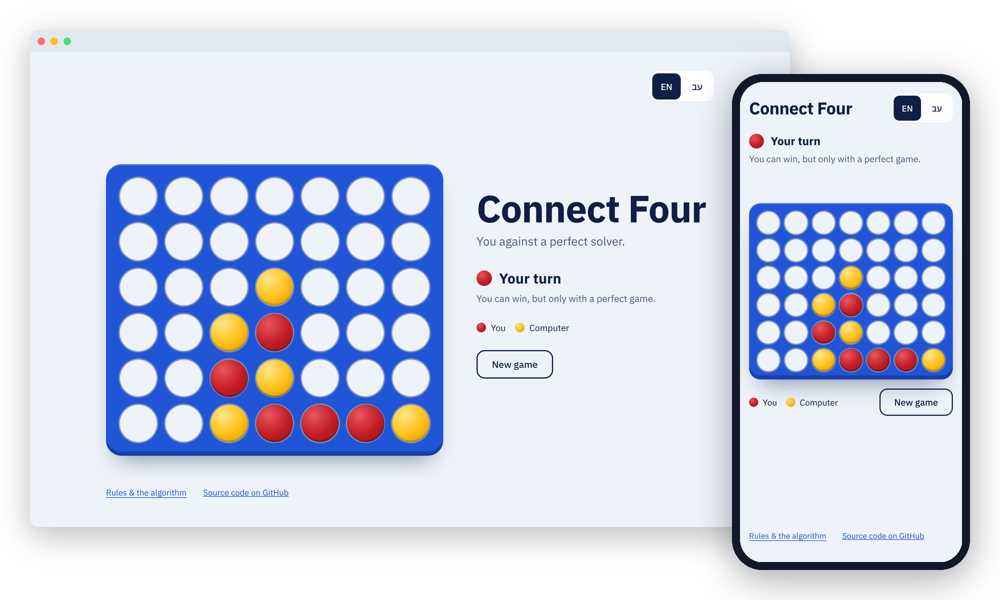
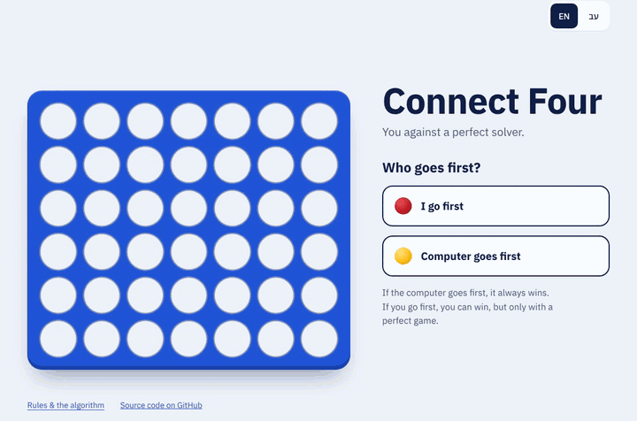

# Connect Four Solver

Play Connect Four against a computer that never makes a mistake.

**[▶ Play it here](https://gilad-benshlomo.github.io/connect-four-solver/)**



## What it does

Connect Four is a solved game: in 1988, James D. Allen and Victor Allis proved that the player who goes first and never makes a mistake always wins. This computer plays perfectly.

- **If the computer goes first, it always wins**, and as fast as it can.
- **If you go first, you can win, but only with a perfect game.** One mistake, and the best you can get is a draw.
- It runs in the browser, on desktop and phone, in English and Hebrew, with nothing to install.

## How it works

The computer does not learn or guess. On every turn it looks for the move with the best result that can be proved, by searching ahead through the game. Connect Four has 4,531,985,219,092 possible positions, so the work is in searching as few of them as possible, and searching those fast.

**The board as two numbers.** Each column takes 7 bits: 6 cells and an empty row on top that stops a line from wrapping into the next column. Dropping a disc is one addition, and four in a row is found with a few bit shifts. The board needs 49 bits, but JavaScript's bitwise operators work on 32, so the board is split by columns into two 32-bit numbers (columns 0–3 and 4–6). A slower version on `BigInt`, which reads like the textbook, stays in the tests as the reference, and the tests check that the two always agree. The split version is about 8× faster.

**The search.** Negamax with alpha-beta pruning: it skips branches that provably cannot change the result. A position's score says not only who wins but when (22 minus the winner's number of discs), so taking the best score picks the fastest win, or, when losing, the longest game. The search then narrows the score with a series of yes/no questions ("is it above this value?"), each with a window of zero width, which prunes far more than one search with a wide window.

**Move ordering.** Alpha-beta prunes the most when the best move is tried first. The search drops every move that lets the opponent win at once, then tries first the moves that create the most threats, and the centre columns first among equals. On hard opening positions this cut the positions explored 10–60×.

**Remembering positions.** The same position can be reached in different orders. A transposition table of 8,388,617 entries (about 40 MB) remembers what was already proved about each one. It stores only 32 of the key's 49 bits; with an odd table size above 2¹⁷, the slot and those bits still identify the position exactly, so a wrong match is impossible.

**An opening book.** The first moves are the slowest to solve: a single position can take many minutes. So every position the computer can face before move 10 was solved in advance, in almost 8 hours of computing, and the move is stored in a book: 3,857 positions, about 70 KB. A position and its mirror image share one entry. When the computer goes first, its first move is the centre: against perfect play, it is the only first move that wins.

**In the browser.** The solver runs in a Web Worker, so the page never freezes while the computer thinks. The page is plain TypeScript with no framework. The discs fall behind the board's face, as in the real game, and every column can be played by mouse, touch or keyboard. The fonts are served by the site itself, with only their Latin and Hebrew letters, so the page makes no requests to other servers.



## Measurements

The speed-ups, step by step, on the first 100 Middle-Easy benchmark positions (mean time per position, on a desktop PC):

| Version | Mean time |
|---|---|
| Alpha-beta | 337 ms |
| + a cap on the best score still possible | 200 ms |
| + centre columns first | 3.4 ms |
| + the transposition table | 0.57 ms |
| + zero-width windows | 0.11 ms |

From the first version to the last: about 3,000× faster. Ordering by threats, added next, cut the mean on Begin-Easy, 1,000 positions near the start of a game, from 14.9 ms to 1.3 ms.

The whole site is about 360 KB of files, and the browser downloads only the fonts it needs. The page's code is about 28 KB (10 KB compressed), and the solver with both opening books about 75 KB (25 KB compressed).

## How correctness is checked

- **Hand-built positions** with scores worked out by hand: wins, losses, draws, and the edge cases between them.
- **Independent versions checked against each other** on seeded random games: the game's rules against both boards (about 10,000 positions), the two boards against each other, alpha-beta against a plain search with no pruning, and the zero-width windows against a full window. Each pair must give the same answers in every position.
- **Published benchmark positions** with known exact scores: both boards must match all 1,000 End-Easy positions.
- **The opening books:** every test run walks every game in which the computer follows the book and the opponent plays any move that does not win at once, and checks that the book has a legal move for each of the 2,212 + 12,627 positions it can face. A separate script checked 94 book positions against the solver, none wrong.
- **Deliberate breaks:** after a test passes, the code is broken on purpose, with a prediction of which tests will fail. When a break was not caught, a test was added. The journey log lists every break and what caught it.

229 tests run in GitHub Actions on every push, before the build; a failing test stops the deployment. 4 more read the published benchmark files and run locally (see below).

## Project structure

```text
src/
  game/       the rules: the board, legal moves, wins and draws, the game state
  solver/     the boards, the search, the transposition table, the opening books, the Web Worker
  ui/         the page: texts in both languages, the game flow, the board, the rules window, fireworks
  main.ts     connects the page to the solver's worker
scripts/      building the opening books, and checking them against the solver
docs/         the development journey and the images in this README
```

## Running locally

Requires [Node.js](https://nodejs.org/) 24.

```bash
npm ci              # install the exact dependency versions from package-lock.json
npm run dev         # start the dev server
npm test            # run the unit tests
npm run build       # type-check and build the site into dist/
npm run measure     # measure the search speed (needs the benchmark files below)
```

The opening books are already in `src/solver/books/`. To build them again (hours), or to check them against the solver (minutes):

```bash
node scripts/buildBook.ts
node scripts/checkBook.ts
```

## Benchmark files

The published benchmark positions are not included in this repository: the tutorial publishes them with a copyright notice and no licence, so they are not redistributed here. To run the tests and measurements that use them:

1. Open the [test protocol page](http://blog.gamesolver.org/solving-connect-four/02-test-protocol/) of the tutorial.
2. Download `Test_L3_R1` (End-Easy), used by the tests and the measurements. The measurements also use `Test_L2_R1` (Middle-Easy), `Test_L1_R1` (Begin-Easy), `Test_L1_R2` (Begin-Medium) and `Test_L1_R3` (Begin-Hard) when they are present.
3. Put the files in a folder named `benchmarks` at the root of the project. The folder is listed in `.gitignore`.

Without the files, the tests and measurements that read them are skipped (as they are in GitHub Actions), and every other test still runs.

## Credits

- The solving approach follows Pascal Pons's tutorial [Solving Connect 4: how to build a perfect AI](http://blog.gamesolver.org/solving-connect-four/01-introduction/): negamax with alpha-beta pruning, the bitboard layout with a helper row, the scoring scheme, and the benchmark positions used to check the solver. His code is not used here; this repository is written from scratch in TypeScript for the browser.
- Connect Four was solved by James D. Allen and, independently, by Victor Allis, in 1988. Allis's work is also the source for the centre being the only first move that wins against perfect play.
- Fonts: [IBM Plex Sans and IBM Plex Sans Hebrew](https://github.com/IBM/plex), under the SIL Open Font License, through [Fontsource](https://fontsource.org/).

## Development journey

[docs/JOURNEY.md](docs/JOURNEY.md) is a running log of how the project was planned and built: every decision with its reasons, every commit, which tests caught each deliberate break, the measurements, and the lessons learned along the way, including a first version in Python that was dropped for TypeScript.

## License

[MIT](LICENSE)
